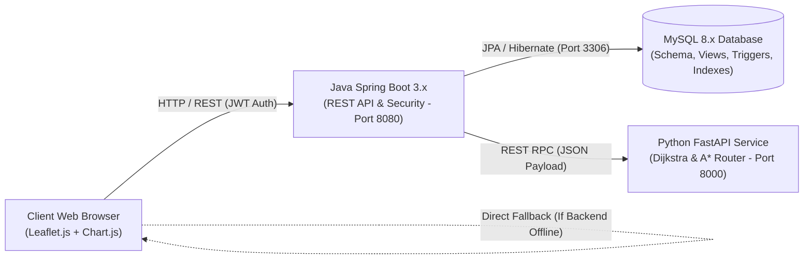

# TRAFFICIQ — Real-Time Traffic Monitoring & Intelligent Route Database

[](https://openjdk.org/)
[](https://spring.io/projects/spring-boot)
[](https://www.python.org/)
[](https://fastapi.tiangolo.com/)
[](https://www.mysql.com/)
[](https://leafletjs.com/)

**TRAFFICIQ** is an enterprise-grade full-stack traffic intelligence and spatial routing platform tailored for the metropolitan region of **Hyderabad, Telangana, India**.

Developed as an academic **B.Tech CSE Database Management Systems (DBMS)** capstone project, it demonstrates complete mastery of **Units I through V** of the DBMS syllabus:
- **Unit I**: Conceptual ER modeling, multi-tier architecture, and logical data independence.
- **Unit II**: Relational schema design, domain and referential integrity constraints, and formal 1NF–3NF/BCNF normalization.
- **Unit III**: Advanced SQL, complex multi-table joins, correlated subqueries, window functions, relational views, and automated database triggers.
- **Unit IV**: Transaction management, ACID properties, isolation levels, and atomic rollback recovery.
- **Unit V**: Primary and secondary composite B-Tree indexing, query cost analysis, and execution plan optimization via `EXPLAIN`.

---

## 1. System Architecture



---

## 2. Technology Stack

| Layer | Technologies Used |
| :--- | :--- |
| **Frontend** | HTML5, CSS3 Custom Properties (Dark & Light themes), Vanilla ES6+ JavaScript, Leaflet.js (OpenStreetMap, Esri World Satellite, CartoDB Dark Matter), Chart.js, Font Awesome |
| **Backend API** | Java 17+ / 21, Spring Boot 3.2.x, Spring Data JPA, Hibernate, Spring Security (Stateless JWT, BCrypt), Bean Validation |
| **Intelligence Engine** | Python 3.10+, FastAPI, Uvicorn, Pydantic, NetworkX / Custom Adjacency Graph, Priority-Queue Dijkstra & A* Pathfinding |
| **Database** | MySQL 8.0+ Community Server (InnoDB Storage Engine, B+ Tree Indexes, Triggers, Views) |

---

## 3. Key Pages & Features

1. **Home / Landing Page (`index.html`)**:
   - Live traffic summary badges, metric KPI cards, and embedded Leaflet preview map.
   - Hyderabad road network highlights with dark/light mode toggle.
2. **Traffic Monitoring Dashboard (`dashboard.html`)**:
   - Interactive spatial map with color-coded congestion polylines (Green: Low, Amber: Moderate, Orange: Heavy, Red: Severe).
   - Multi-layer toggle: Street Map vs. Esri Satellite Imagery.
   - Street View modal with panoramic photography cards for Hyderabad junctions.
   - Live traffic incident alert feed and searchable corridor table.
3. **Intelligent Route Planner (`routes.html`)**:
   - Multi-criteria route optimization (Fastest vs. Shortest vs. Balanced) connecting 16 Hyderabad junctions.
   - Side-by-side alternative route comparisons (distance, travel duration, efficiency score $0-100$).
   - Turn-by-turn corridor segment breakdown.
4. **Road Network Explorer (`roads.html`)**:
   - Full CRUD table for road network segments with referential integrity constraints.
   - Admin-only "Add Road", "Edit", and "Delete" actions.
5. **Traffic Incident Management (`incidents.html`)**:
   - Full CRUD for traffic incidents, road closures, accidents, and waterlogging alerts.
   - Database trigger integration: creating high/critical incidents immediately degrades road speeds; resolving them restores normal flow.
6. **Analytics & Statistical Reports (`analytics.html`)**:
   - Four interactive Chart.js visualizations (Congestion donut, hourly speed trends, top congested corridors, road hierarchy).
   - Instant CSV report export.
7. **Authentication & Admin Portal (`login.html`)**:
   - Role-Based Access Control (RBAC) supporting `ROLE_ADMIN` and `ROLE_USER`.
   - One-click demo credential auto-fill buttons.

---

## 4. Default Login Credentials

| Role | Email Address | Password | Permissions |
| :--- | :--- | :--- | :--- |
| **System Administrator** | `admin@trafficiq.com` | `Admin@123` | Full CRUD on Roads & Incidents, Trigger executions, Audits |
| **Regular Commuter** | `user@trafficiq.com` | `User@123` | Read-only traffic browsing, route calculations, incident reporting |

---

## 5. Local Setup & Execution Guide (Windows PowerShell)

### Prerequisites
- **Java Development Kit (JDK 17 or 21)**
- **Python 3.10+**
- **MySQL 8.0+**
- Modern Web Browser (Chrome, Edge, Firefox)

---

### Step 1: Database Setup (MySQL 8.x)

Open PowerShell and navigate to the `database` folder:

```powershell
cd C:\Users\Suhitha\.gemini\antigravity\scratch\trafficiq\database

# Execute SQL scripts in sequential order into MySQL
mysql -u root -p -e "source schema.sql;"
mysql -u root -p -e "source seed.sql;"
mysql -u root -p -e "source views.sql;"
mysql -u root -p -e "source triggers.sql;"
mysql -u root -p -e "source indexes.sql;"
```

> **Note**: If you don't have local MySQL running, the Java backend includes an **H2 in-memory profile** that boots automatically when running with `--spring.profiles.active=h2`.

---

### Step 2: Start the Python Traffic Intelligence Service

Open a new PowerShell terminal:

```powershell
cd C:\Users\Suhitha\.gemini\antigravity\scratch\trafficiq\python-service

# Create and activate virtual environment
python -m venv venv
.\venv\Scripts\Activate.ps1

# Install dependencies
pip install -r requirements.txt

# Run unit tests to verify Dijkstra pathfinding
pytest tests/

# Start FastAPI microservice
uvicorn main:app --host 0.0.0.0 --port 8000 --reload
```

- API Docs available at: `http://localhost:8000/docs`
- Healthcheck endpoint: `http://localhost:8000/health`

---

### Step 3: Start the Java Spring Boot Backend

Open a third PowerShell terminal:

```powershell
cd C:\Users\Suhitha\.gemini\antigravity\scratch\trafficiq\java-backend

# Run using Maven wrapper or installed Maven
mvn spring-boot:run
```

- Backend REST API will start on: `http://localhost:8080`
- If using H2 in-memory fallback: `mvn spring-boot:run -Dspring-boot.run.profiles=h2`

---

### Step 4: Open and Explore the Frontend

You can open `frontend/index.html` directly in your browser, or serve it using Python's simple HTTP server or VS Code Live Server:

```powershell
cd C:\Users\Suhitha\.gemini\antigravity\scratch\trafficiq\frontend

# Start local web server on port 5500
python -m http.server 5500
```

Open `http://localhost:5500` in Google Chrome or Microsoft Edge.

> **Resilient Offline Architecture**: If the backend is not yet started, the frontend automatically falls back to the embedded Hyderabad spatial dataset, ensuring full interactive demonstration without runtime errors.

---

## 6. REST API Specification

### Java Spring Boot (`http://localhost:8080`)

| Method | Endpoint | Access | Description |
| :--- | :--- | :--- | :--- |
| `POST` | `/api/auth/login` | Public | Authenticates user; returns signed JWT token |
| `GET` | `/api/auth/me` | User / Admin | Retrieves authenticated profile and roles |
| `GET` | `/api/locations` | Public | Lists all 16 Hyderabad spatial junction nodes |
| `GET` | `/api/roads` | Public | Lists all road network segments with live telemetry |
| `POST` | `/api/roads` | **Admin Only** | Adds a new road segment (enforces constraints) |
| `PUT` | `/api/roads/{id}` | **Admin Only** | Modifies road parameters (speed limit, lanes) |
| `DELETE` | `/api/roads/{id}` | **Admin Only** | Deletes a road segment (cascades snapshots) |
| `GET` | `/api/incidents` | Public | Lists all reported traffic incidents |
| `GET` | `/api/incidents/active`| Public | Lists unresolved active incidents |
| `POST` | `/api/incidents` | **Admin Only** | Reports incident (triggers speed degradation) |
| `PUT` | `/api/incidents/{id}` | **Admin Only** | Updates status (e.g. `RESOLVED` restores speed) |
| `POST` | `/api/routes/plan` | Public | Delegates graph routing to Python Dijkstra engine |
| `GET` | `/api/traffic/summary` | Public | Aggregated network health metrics |
| `GET` | `/api/analytics/data` | Public | Telemetry datasets for Chart.js rendering |
| `GET` | `/api/analytics/export-csv`| Public | Downloads CSV report of monitored corridors |

### Python Microservice (`http://localhost:8000`)

| Method | Endpoint | Description |
| :--- | :--- | :--- |
| `GET` | `/health` | Service health status and node/edge graph counts |
| `GET` | `/locations` | Mapped Hyderabad junction coordinates |
| `POST` | `/optimize-route` | Executes Dijkstra & A* search; computes alternative paths and route scores |
| `POST` | `/analyze-traffic` | Evaluates network bottlenecks, average speeds, and health index |

---

## 7. Documentation & Viva Preparation

Comprehensive documentation files are included in the `docs/` folder:
- **[architecture.md](docs/architecture.md)**: Detailed multi-tier architectural specifications, data flows, and security model.
- **[er-diagram.md](docs/er-diagram.md)**: Complete Mermaid ER diagram, relational schemas, and formal 1NF–3NF/BCNF normalization proofs.
- **[dbms-syllabus-mapping.md](docs/dbms-syllabus-mapping.md)**: Tabular alignment of Units I–V with concrete tables, scripts, and queries.
- **[viva-questions.md](docs/viva-questions.md)**: 20 rigorous, project-specific DBMS viva questions with complete technical answers.

---

## 8. Testing & Verification Checklist

- [x] **Theme Persistence**: Switching between Dark Mode and Light Mode persists across all 7 pages via `localStorage`.
- [x] **Map Multi-Layering**: Toggle between OpenStreetMap, Esri World Imagery (Satellite), and Dark CartoDB tiles.
- [x] **Street View Integration**: Clicking "Street View Preview" on any road opens a modal with junction imagery and external Google Street View launch link.
- [x] **Dijkstra Algorithm**: Route planning computes optimal path between HITEC City, Jubilee Hills, Secunderabad, and RGIA Airport with positive distance and duration.
- [x] **Database Normalization**: Schema is verified in BCNF; foreign keys prevent orphan snapshots or invalid endpoints.
- [x] **Automated Triggers**: Trigger `trg_after_incident_insert` degrades road speed upon reporting an incident; `trg_after_incident_update` restores flow upon resolution.
- [x] **Role-Based Access Control**: Standard users cannot modify roads; Admin login (`admin@trafficiq.com` / `Admin@123`) enables full CRUD actions.
- [x] **CSV Export**: Clicking "Export Report (CSV)" downloads a clean comma-separated file of all road telemetry.

---

## 9. Troubleshooting

| Issue | Cause | Solution |
| :--- | :--- | :--- |
| `CommunicationsException: Communications link failure` | MySQL is not running on port 3306 | Start MySQL service via Windows Services or run Spring Boot with `--spring.profiles.active=h2` |
| `Port 8080 already in use` | Another process is holding port 8080 | Change `server.port=8081` in `application.properties` or kill the process: `Stop-Process -Id (Get-NetTCPConnection -LocalPort 8080).OwningProcess -Force` |
| `Python script fails with ModuleNotFoundError` | Virtualenv dependencies missing | Ensure you ran `pip install -r requirements.txt` inside active virtual environment |
| `CORS Error in Browser Console` | Backend is rejecting frontend origin | Both Spring Boot (`SecurityConfig.java`) and FastAPI (`main.py`) have explicit `allow_origins=["*"]` configured |
