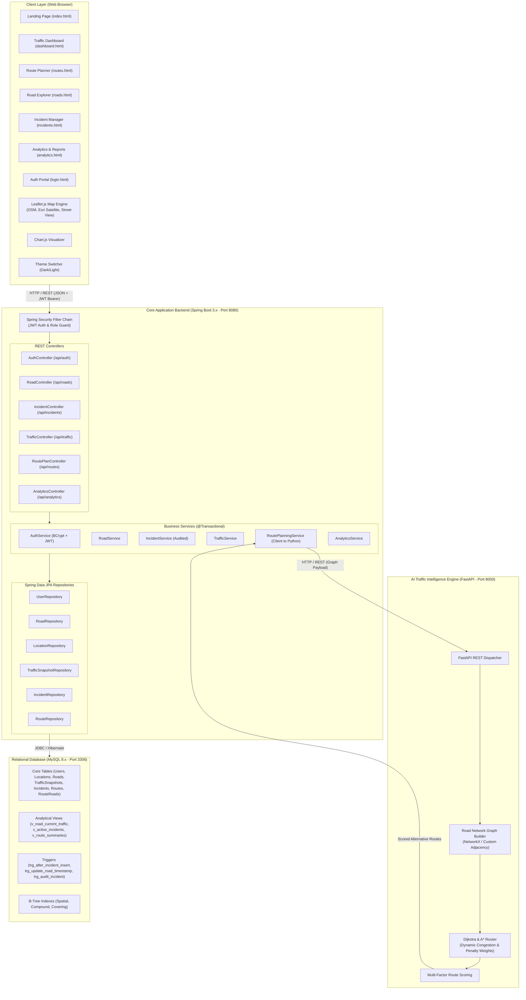

# TRAFFICIQ — System Architecture & Design Specification

## 1. System Overview

**TRAFFICIQ** is an enterprise-grade, multi-tier academic full-stack platform for real-time traffic monitoring, incident management, road network exploration, and intelligent route optimization for the metropolitan area of Hyderabad, Telangana, India.

The project demonstrates deep integration of:
- **Presentation Layer (Frontend)**: Modern vanilla HTML5, CSS3 with responsive Grid/Flexbox, ES6+ JavaScript modules, Leaflet.js interactive maps with multi-tile switching (Standard Street, Satellite, Dark, Hybrid), Street View preview modal, and Chart.js analytics dashboards.
- **Application & Security Tier (Java Backend)**: Java 17+ and Spring Boot 3.2.x REST APIs, Spring Data JPA / Hibernate, Spring Security with BCrypt password hashing, Stateless JWT Authentication, Role-Based Access Control (`ROLE_ADMIN`, `ROLE_USER`), declarative `@Transactional` management, and input validation.
- **Traffic Intelligence & Optimization Engine (Python Service)**: Python 3.10+ and FastAPI microservice implementing graph algorithms (Dijkstra's Shortest Path & A* Heuristic Search) across a weighted road network model factoring physical distance, instantaneous speed limits, congestion multipliers, and active traffic incident penalties.
- **Relational Database Management System (DBMS)**: MySQL 8.x schema implementing 1NF through 3NF/BCNF normalization, foreign key referential integrity constraints, primary and secondary composite/covering B-Tree indexes, materialized and relational views, ACID transaction isolation, and audit triggers.

---

## 2. Multi-Tier Architecture Diagram

---

## 3. Component Breakdown & Port Allocations

| Component | Technology | Default Port | Primary Responsibilities |
| :--- | :--- | :--- | :--- |
| **Frontend Web App** | HTML5, CSS3, ES6 JS, Leaflet, Chart.js | `80` / `5500` / Local File | UI/UX, Map rendering, Real-time status polling, Theme management, Forms |
| **Java Spring Boot API** | Java 21 / 17, Spring Boot 3.2.x, Hibernate | `8080` | CRUD operations, Business logic, Security, RBAC, DB transactions, Gateway to Python |
| **Python Intelligence** | Python 3.10+, FastAPI, Uvicorn, Pydantic | `8000` | Graph representation, Dijkstra & A* routing, dynamic speed/incident weighting |
| **Relational Database** | MySQL 8.0+ Community Server | `3306` | Normalized data persistence, ACID enforcement, indexes, views, audit triggers |

---

## 4. Data Flow Specifications

### A. Live Traffic Monitoring Flow
1. Client opens `dashboard.html`. Leaflet map initializes at Hyderabad coordinates `[17.3850, 78.4867]` with zoom level 12.
2. Frontend requests `GET /api/traffic/current-summary` from Spring Boot.
3. Spring Boot invokes `TrafficService` querying the MySQL view `v_road_current_traffic`.
4. The JSON response returns current congestion states, average speeds, coordinates, and active incident markers.
5. Frontend colors polylines (Green: Low, Amber: Moderate, Orange: Heavy, Red: Severe) and mounts interactive incident popups.
6. A status badge prominently indicates: `"Demo / Simulated Traffic Data"`.

### B. Intelligent Route Planning Flow
1. User selects Origin (e.g. *HITEC City - Cyber Towers*) and Destination (e.g. *Secunderabad Railway Station*) and selects a route preference (*Fastest*, *Shortest*, or *Balanced*).
2. Frontend calls `POST /api/routes/plan` on Java Backend.
3. Java backend retrieves active road segment weights from MySQL (combining base distances, current speed limits, congestion multipliers, and incident delays).
4. Java backend delegates the graph payload to Python FastAPI at `POST http://localhost:8000/optimize-route`.
5. Python `DijkstraRouter` computes:
   - Primary optimal route
   - Alternative Route 1 (e.g. via Outer Ring Road or PVNR Expressway)
   - Alternative Route 2 (e.g. via Jubilee Hills Road No. 36)
6. Python calculates efficiency scores ($0 - 100$) based on distance, estimated duration, congestion factor, and safety indices.
7. Scored routes are returned to Java backend, optionally cached or persisted in `Routes` and `RouteRoads` tables, and returned to client.
8. Frontend plots color-coded comparison polylines and displays a route comparison card matrix.

### C. Traffic Incident Management (RBAC) Flow
1. Public users can browse active incidents (`GET /api/incidents`).
2. Admin logs in with `admin@trafficiq.com` / `Admin@123` at `/login.html`, receiving a signed JWT token.
3. Admin submits an incident report or changes status to `RESOLVED` via `POST /api/incidents` or `PUT /api/incidents/{id}`.
4. Spring Security validates the `Bearer <token>` and ensures `ROLE_ADMIN` authority.
5. In MySQL, the update triggers `trg_after_incident_update`, updating the road's current congestion snapshot and creating an entry in `AuditLogs`.

---

## 5. Security & RBAC Architecture

1. **Authentication**: Stateless JSON Web Token (JWT) with HS256 algorithm.
2. **Password Storage**: One-way BCrypt salt-hashing with strength factor 10.
3. **Role Hierarchy**:
   - `ROLE_ADMIN`: Full CRUD on `/api/roads/**`, `/api/incidents/**`, user administration, and system configurations.
   - `ROLE_USER`: Read-only access to roads, traffic feeds, incident reports; read-write access to private saved route plans.
   - `PUBLIC`: Unauthenticated access to landing page, dashboard maps, public route planner preview, and `/api/auth/login`.
4. **CORS Configuration**: Restricts cross-origin requests to trusted origins while allowing developer port flexibility (`localhost:5500`, `localhost:3000`, `127.0.0.1:8080`, etc.).

---

## 6. Theme Engine (Dark & Light System)

The visual design system uses CSS Custom Properties declared at `:root` and overridden via `[data-theme="light"]`:
- **Dark Theme (Default)**: Deep Navy (`#0A0F1D`), Slate Card Surface (`#121B2F`), Electric Blue Accent (`#0070F3`), Neon Cyan Accent (`#00DFD8`), Subtle Emerald Indicator (`#10B981`).
- **Light Theme**: Crisp Porcelain (`#F8FAFC`), Pure White Surface (`#FFFFFF`), Deep Navy Typography (`#0F172A`), Vivid Royal Blue Accent (`#2563EB`), Bright Teal Accent (`#0D9488`).
- **Persistence**: Checked on every page load via an inline `<script>` reading `localStorage.getItem('trafficiq_theme')` to prevent flash-of-unstyled-theme (FOUT).

---

## 7. Map & Spatial Architecture

- **Base Layers**:
  - OpenStreetMap Standard: Street-level vector-rendered cartography.
  - Esri World Imagery: High-resolution satellite tiles (`https://server.arcgisonline.com/ArcGIS/rest/services/World_Imagery/MapServer/tile/{z}/{y}/{x}`).
  - CartoDB Dark Matter / Voyager: Themed base maps matching Dark/Light dashboard modes.
- **Overlays**:
  - Real-time Road Segment Polylines with dynamic stroke color and width.
  - Interactive Incident Markers with animated pulsating CSS rings for critical severity.
  - Key Landmark Markers (Charminar, Cyber Towers, HITEC City, Airport, Secunderabad Station).
- **Street View Integration**:
  - Modal with 360-degree interactive panoramic embed / high-resolution photographic street view cards for key Hyderabad junctions (Cyber Towers, Gachibowli Flyover, Paradise Circle, Panjagutta Junction).
  - External launch button directly opening Google Street View coordinates at the selected road coordinate.
