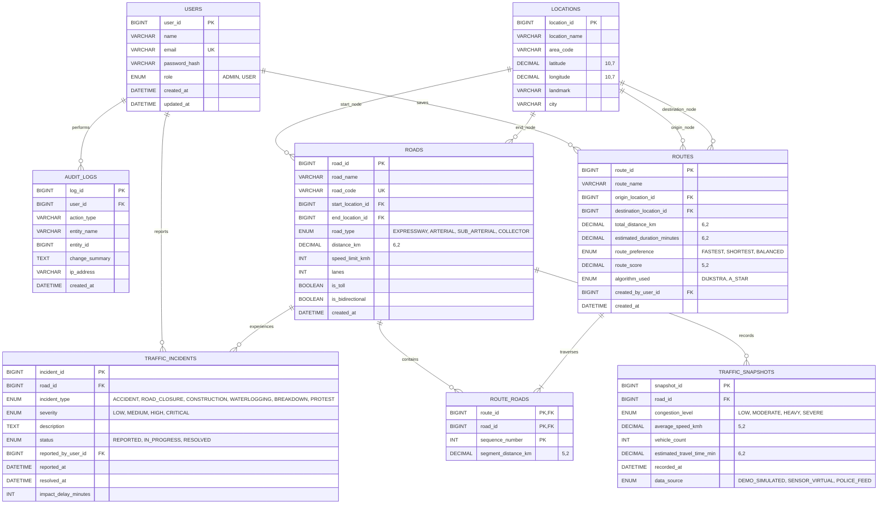

# TRAFFICIQ — Entity-Relationship (ER) Modeling & Relational Schema

## 1. Entity-Relationship (ER) Diagram

---

## 2. Relational Schema Representation (DDL Form)

1. **Users** (`user_id` [PK], `name`, `email` [UQ], `password_hash`, `role`, `created_at`, `updated_at`)
2. **Locations** (`location_id` [PK], `location_name`, `area_code`, `latitude`, `longitude`, `landmark`, `city`)
3. **Roads** (`road_id` [PK], `road_name`, `road_code` [UQ], `start_location_id` [FK -> Locations.location_id], `end_location_id` [FK -> Locations.location_id], `road_type`, `distance_km`, `speed_limit_kmh`, `lanes`, `is_toll`, `is_bidirectional`, `created_at`)
4. **TrafficSnapshots** (`snapshot_id` [PK], `road_id` [FK -> Roads.road_id], `congestion_level`, `average_speed_kmh`, `vehicle_count`, `estimated_travel_time_min`, `recorded_at`, `data_source`)
5. **TrafficIncidents** (`incident_id` [PK], `road_id` [FK -> Roads.road_id], `incident_type`, `severity`, `description`, `status`, `reported_by_user_id` [FK -> Users.user_id], `reported_at`, `resolved_at`, `impact_delay_minutes`)
6. **Routes** (`route_id` [PK], `route_name`, `origin_location_id` [FK -> Locations.location_id], `destination_location_id` [FK -> Locations.location_id], `total_distance_km`, `estimated_duration_minutes`, `route_preference`, `route_score`, `algorithm_used`, `created_by_user_id` [FK -> Users.user_id], `created_at`)
7. **RouteRoads** (`route_id` [PK, FK -> Routes.route_id], `road_id` [PK, FK -> Roads.road_id], `sequence_number` [PK], `segment_distance_km`)
8. **AuditLogs** (`log_id` [PK], `user_id` [FK -> Users.user_id], `action_type`, `entity_name`, `entity_id`, `change_summary`, `ip_address`, `created_at`)

---

## 3. Normalization Verification (DBMS Syllabus Unit II)

### First Normal Form (1NF)
- **Criterion**: Every attribute value is atomic (indivisible). No repeating groups, arrays, or comma-separated lists stored in columns.
- **Verification**:
  - Instead of storing multiple roads for a route as a comma-separated list like `roads: "1,4,7"`, we decomposed the relation into the bridge table `RouteRoads` where each pair (`route_id`, `road_id`, `sequence_number`) is an individual atomic record.
  - Coordinate attributes `latitude` and `longitude` are separated into distinct numeric columns rather than a single string composite `"17.3850, 78.4867"`.

### Second Normal Form (2NF)
- **Criterion**: The relation is in 1NF and contains no **Partial Functional Dependencies** (every non-prime attribute must depend on the whole candidate key, not a proper subset of any candidate key).
- **Verification**:
  - In `RouteRoads`, the composite candidate key is `{route_id, road_id, sequence_number}`. The non-key attribute `segment_distance_km` represents the length of this specific road segment within this sequence of the route. No attribute depends only on `{route_id}` or only on `{road_id}`.
  - Road metadata (such as `road_name`, `speed_limit`) is strictly isolated inside the `Roads` table, preventing partial dependency anomalies inside `RouteRoads`.

### Third Normal Form (3NF)
- **Criterion**: The relation is in 2NF and contains no **Transitive Functional Dependencies** (no non-prime attribute is transitively dependent on any candidate key; i.e., $X \to Y \to Z$ where $Y$ is not a superkey).
- **Verification**:
  - In `Roads`, we do not store `start_location_name`, `start_latitude`, or `city`. If we did, we would have $RoadID \to StartLocationID \to StartCity$, which is a transitive dependency.
  - Instead, `Roads` references `start_location_id` which acts as a Foreign Key to `Locations`. If a location's landmark or coordinates change, they are modified in exactly one place in `Locations`.

### Boyce-Codd Normal Form (BCNF)
- **Criterion**: For every non-trivial functional dependency $X \to Y$, $X$ must be a superkey.
- **Verification**:
  - In `Users`, the functional dependencies are:
    - $user\_id \to \{name, email, password\_hash, role, created\_at\}$
    - $email \to \{user\_id, name, password\_hash, role, created\_at\}$
  - Both `user_id` and `email` are unique keys (superkeys). Thus, `Users` satisfies BCNF.
  - Similar conditions hold for `Locations` and `Roads` where `road_code` is also a unique alternate candidate key.

---

## 4. Relational Algebra Formulations

### Example 1: Active Incidents on Major Arterial Roads
Selection ($\sigma$) and Natural Join ($\bowtie$):
$$\Pi_{road\_name, incident\_type, severity} \left( \sigma_{status='REPORTED' \land road\_type='ARTERIAL'} (TrafficIncidents \bowtie Roads) \right)$$

### Example 2: Most Congested Roads Currently
Join, Projection, and Condition:
$$\Pi_{road\_name, congestion\_level, average\_speed\_kmh} \left( \sigma_{congestion\_level \in \{'HEAVY', 'SEVERE'\}} (Roads \bowtie TrafficSnapshots) \right)$$

### Example 3: Roads Traversed by a Specific Route
Join over bridge table:
$$\Pi_{sequence\_number, road\_name, distance\_km} \left( \sigma_{route\_id = 1} (RouteRoads \bowtie Roads) \right)$$
